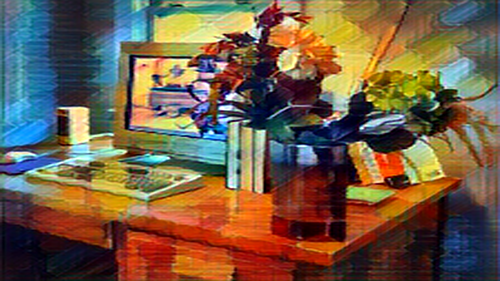

# styletransfer

This is a simple camera demo that uses ML AI style transfer. It displays your default camera feed, and uses an ONNX model to apply a style transfer. There are a few to choose from. It uses these pre-trained models from the [ONNX Model Zoo](https://huggingface.co/onnxmodelzoo):
* mosaic
* candy
* rain-princess
* udnie
* pointilism

## Example
It works best on a live camera feed, but here's a still image with the different effects applied.

Raw source:

Mosaic:

Candy:

Rain-princess:

Udnie:

Pointilism:

## Controls
Use the following keyboard keys:
* 0 - Show raw camera view
* 1 through 5 - toggle the above models. If some couldn't be loaded for some reason then only a subset will be available.
* Escape - Exit the program
* F - toggle windowed and fullscreen mode
* D - toggle diagnostic text, like the model name and frame counter, on and off

## Build
The project is written in C# and is built using Visual Studio 2019. It takes dependences on the following packages through NuGet:
* Microsoft.ML.OnnxRuntime
* OpenCvSharp4
* OpenCvSharp4.runtime.win

It uses OpenCV for loading the webcam and window management, and ONNX to do the MLAI evaluation. 

## Testing
This project was tested on Windows 10 x64, on i7-10700K. The evaluation is done on CPU, for the time being. It gets evaluated at a small size then scaled up to fit the window. If you want to change the evaluation size, change the ModelWidth and ModelHeight variables.
