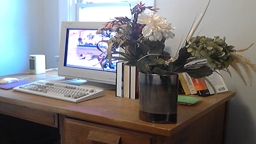
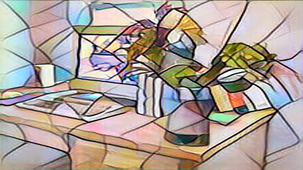
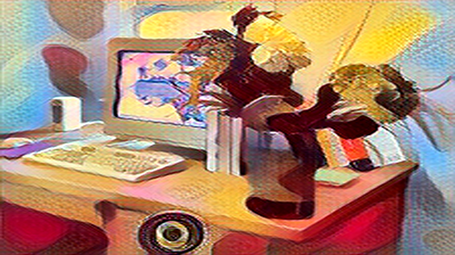
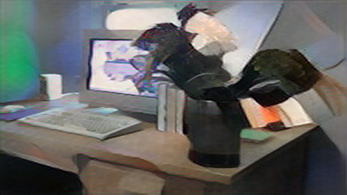
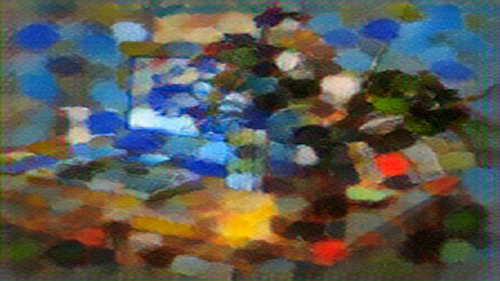

# Hackforge ML AI Style Transfer Demo

This is a simple camera demo that uses ML AI style transfer. 

For background, a style transfer is a machine learning technique that takes the visual content of one image and blends it with the artistic style of another reference image. For example, you can feed the algorithm a photograph of your car, with a model trained on a bunch of classic paintings; the output will look like your car, with a painting effect.

The models for this demo come from a popular suite of models known as Fast Neural Style Transfer, which were originally developed by researcher Justin Johnson and adapted heavily into the PyTorch Examples repository before being converted into ONNX format. 

The datasets used for the models come from artwork in the public domain. If you like, you can update the app to include your own models.

The application displays your default camera feed, and uses an ONNX model to apply a style transfer. There are a few to choose from. It uses these pre-trained models from the [ONNX Model Zoo](https://huggingface.co/onnxmodelzoo):
* mosaic
* candy
* udnie
* pointilism

## Example
It works best on a live camera feed, but here's a still image with the different effects applied.

Raw source:

Mosaic:

Candy:

Udnie:

Pointilism:

## Controls
Use the following keyboard keys:
* 0 - Show raw camera view
* 1 through 5 - toggle the above models. If some couldn't be loaded for some reason then only a subset will be available.
* Escape - Exit the program
* F - toggle windowed and fullscreen mode
* D - toggle diagnostic text, like the model name and frame counter, on and off

## Testing
This project was tested on Windows 10 x64, on i7-10700K. The evaluation is done on CPU, for the time being. It gets evaluated at a small size then scaled up to fit the window. If you want to change the evaluation size, change the ModelWidth and ModelHeight variables.

## Build
The project is written in C# and is built using Visual Studio 2019. It takes dependences on the following packages through NuGet:
* Microsoft.ML.OnnxRuntime
* OpenCvSharp4
* OpenCvSharp4.runtime.win

It uses OpenCV for loading the webcam and window management, and ONNX to do the MLAI evaluation. 
